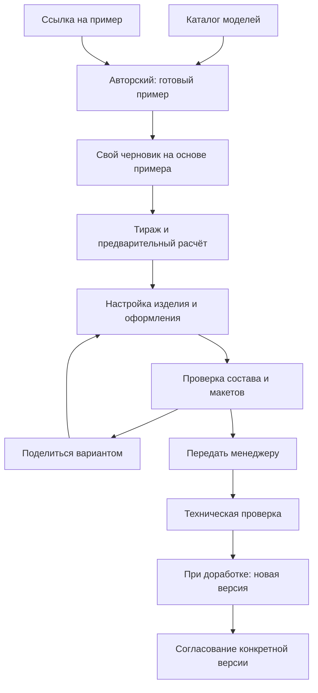

# Клиентский флоу «Авторского», предложение v1

Основа: подтверждённые решения в [интервью](discovery.md), [аудит Roundprint](audits/roundprint-9f9f364/README.md) и дополнительная расшифровка обсуждения 10:15–18:38, переданная 11 сентября 2026 года. Реплики участников записи служат материалом для проектирования, не автоматически принятыми требованиями.

## Вход через готовый пример

Сохраняем ранее выбранный пользователем каталог моделей. После выбора «Авторского» открываем полноценный демонстрационный проект: исходный макет, собранный калейдоскоп и компактный список задействованных опций. Человек сразу видит, что можно получить и за счёт каких настроек.

Основное действие: «Сделать свой на основе этого». Оно создаёт собственный черновик, сохраняя демонстрационный пример. Вход по ссылке на конкретный пример может сразу открывать этот экран, минуя каталог. Это предложение двух входов в один сценарий, а не два редактора.

Схема показывает основной путь. Просмотр по ссылке, сохранение и передача менеджеру являются разными действиями. Техническая проверка нужна также для самостоятельно подготовленного оформления; платная помощь остаётся отдельной опцией.

## Как устроен экран

- Постоянный 3D-просмотр изделия. Деталь можно выбрать прямо на модели.
- Компактная панель показывает настройки текущего шага. «Далее», меню и нажатие на деталь меняют один и тот же текущий шаг.
- Тираж, цена штуки, сумма заказа и срок доступны постоянно; изменение тиража не требует возвращаться к началу. Разовые услуги учитываются один раз на заказ по тарифу выбранного тиража.
- На входе видна небольшая развёртка макета рядом с результатом. При редактировании она раскрывается в рабочую область с доступным 3D.
- Обучение открывается рядом с конкретным инструментом по запросу. Наличие и содержание роликов ещё нужно определить.

## Предлагаемая группировка настроек

| Шаг | Что делает человек | Что видит |
| --- | --- | --- |
| Корпус | Выбирает фон | Изменение поверхности собранного изделия |
| Оформление | Загружает изображение, размещает слои, назначает белила и лак либо оставляет пожелания для помощи | Макет и соответствующий результат на корпусе |
| Кольца | Выбирает цвета, затем при необходимости многоцветный рисунок | Выбранное кольцо крупно и на изделии |
| Эльвинг и насыпка | Выбирает наполнение и размещение логотипа | Внешний вид, отдельный режим просмотра узора |
| Подставка и коробка | Выбирает комплектацию и при наличии оформления открывает соответствующую развёртку | Выбранный предмет и нанесённый на него макет |
| Услуги и проверка | Выбирает помощь, пробную печать или образец, проверяет состав | Предварительный расчёт и состав перед передачей менеджеру |

Наследуем исходные опции Tilda, а не добавляем вымышленные материалы. Порядок и объединение шагов ещё можно изменить по результатам проверки интерфейса. Не все перечисленные редакторские операции уже реализованы.

## Ссылка и сохранение

Предлагается разрешить просмотр примера и начало настройки без регистрации. Для сохранения проекта надолго предложить вход, а для демонстрации результата дать отдельное действие «Поделиться». Просматривающий по ссылке не получает автоматически право менять исходный проект. Страница согласования должна показывать, какую именно версию подтверждает клиент.

В записи обсуждаются продление временной ссылки при посещении и срок 30 дней. Срок хранения, удаление, правила восстановления и момент регистрации не приняты. Их нельзя включать в реализацию как готовую политику. Обсуждение через Telegram или иной канал также пока идея, канал и способ связи не выбраны.

## Что меняется относительно первых imagegen-макетов

1. Между каталогом и настройкой появляется готовый пример с парой «макет → изделие» и перечнем включённых опций. Его можно разместить прямо в основной компоновке, без дополнительной обязательной страницы.
2. Развёртка становится частью клиентского сценария. Для корпуса, подставки и коробки нужны свои области оформления в одном проекте.
3. Просмотр через призму должен отражать выбранную насыпку и логотип. Сгенерированное изображение узора в текущем макете показывает только расположение инструмента.
4. Появляются явные действия для создания собственного варианта, отправки ссылки и передачи менеджеру. Экран кабинета пока не проектируется как обязательный старт.

Текущие PNG не изменены. Они остаются первой визуальной итерацией; этот документ задаёт следующую.

## Следствия по codebase-design

| Module | Interface и скрываемая implementation | Опора на существующее |
| --- | --- | --- |
| Сценарий настройки | Принимает выбор шага или детали и возвращает активную настройку; скрывает переходы и доступность опций | Новая компоновка вокруг операций Roundprint и правил Tilda |
| Документ оформления | Принимает команды над выбранной областью оформления; возвращает снимок слоёв и назначений эффектов | Существующий редактор, с отделением состояния от страницы |
| Оптический просмотр | Получает состав камеры, положение логотипа и движение, возвращает изображение узора | Отдельная исследуемая implementation; точность ещё не доказана |
| Проект и версии | Создаёт собственный вариант из примера, сохраняет версии и выдаёт ссылки с определёнными правами | Текущее сохранение Roundprint требует исправлений из аудита |

Не создаём adapter лампы заранее. Разные поверхности оформления уже нужны внутри «Авторского», но их геометрия, развёртки и печатные ограничения должны быть проверены. Предложение модулей не означает утверждённый перенос кода между репозиториями.

## Что проверять следующим

Один сценарий для сравнения интерфейсов: открыть готовый пример, создать свой вариант, задать тираж, заменить оформление, выбрать деталь на 3D, включить эффект и показать результат коллеге. Проверяем, понимает ли человек связь макета, результата и цены и может ли пройти путь без обязательного обучения.

Отдельно проверить техническую возможность узора через призму на предоставленной геометрии: логотип на стекле, внутри эльвинга и в насыпке могут давать разный результат. Движение сухой насыпки, звук и встряхивание телефона являются идеями записи; они не должны подменять проверку самого оптического эффекта.

Произвольный импорт PSD упоминается в записи как желаемый путь. Предыдущий аудит не обнаружил его в интерфейсе: есть экспорт PSD и подготовленные демонстрационные ресурсы. До реализации и проверки не обещаем клиенту полноценный импорт PSD.
