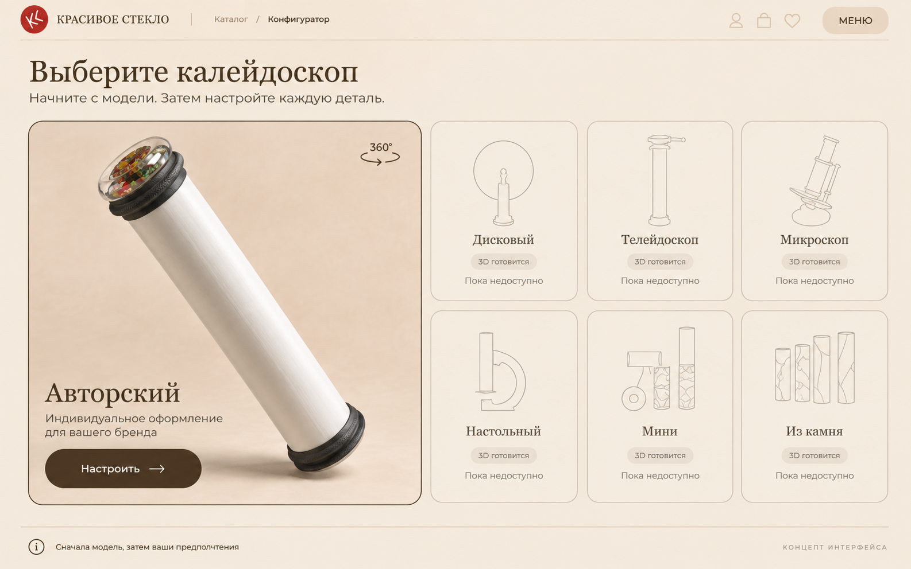
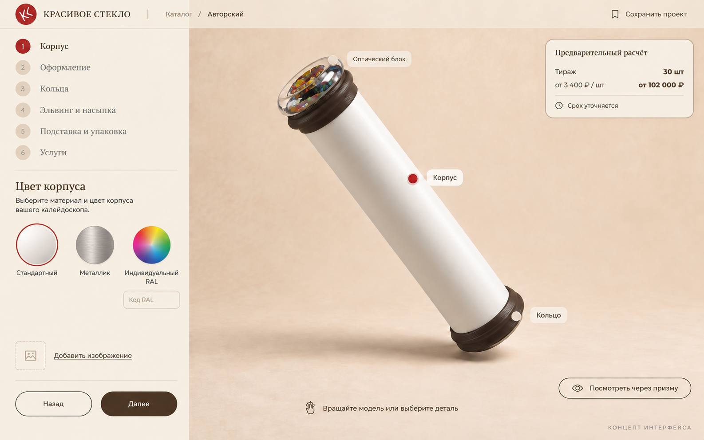
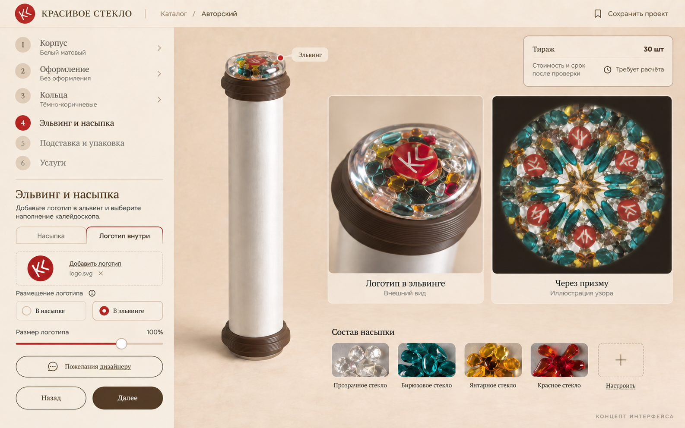
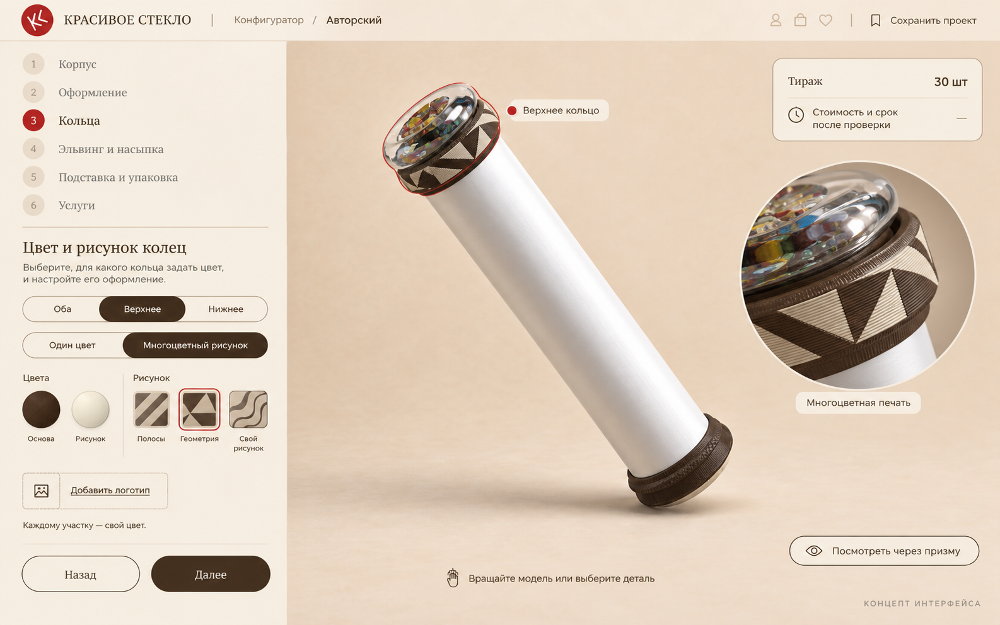

# Макеты конфигуратора «Авторский»

Четыре экрана одного направления интерфейса, созданные 11 сентября 2026 года встроенным imagegen. Это растровые макеты для обсуждения, рабочий интерфейс ещё не реализован.

## 1. Выбор модели

«Авторский» доступен для настройки. Остальные модели показаны заглушками.

## 2. Пошаговая настройка

Компактное меню слева, постоянная собранная модель справа. Шаги, меню и нажатия на детали должны выбирать одну настройку. В макете показана предварительная стоимость для 30 штук: 3 400 ₽ за штуку, 102 000 ₽ за заказ.

## 3. Насыпка, логотип и призма

Предложение интерфейса для выбора насыпки, размещения логотипа внутри и просмотра узора. Размещение в насыпке и в эльвинге показано как два варианта для дальнейшей проверки конструкции.

Узор через призму иллюстративный. Он не получен физической симуляцией предоставленной модели и не подтверждает оптическую видимость логотипа.

## 4. Многоцветные кольца

Выбор кольца, цветов и узора, загрузка своего оформления. Два цвета служат примером, а не ограничением принтера. Подготовку геометрии и проверку печати на Snapmaker U1 предстоит разработать.

## Источники и воспроизводимость

- [Промпты](prompts.md), режим: встроенный imagegen.
- Визуальные ориентиры: [главная Tilda](https://krasivoesteklo.ru/) и [действующий конфигуратор](https://krasivoesteklo.ru/configurator). Снимки сохранены в references.
- Палитра действующего конфигуратора: персиковый #edccad, коричневый #463321, красный #BE0008, тёмный бирюзовый #04434B; заголовки с засечками.
- [Рендер CAD для генерации](references/cad-reference.png), [скрипт](references/render-cad.py), [данные деталей](references/cad-parts.json). Исходники пользователя прочитаны из `/Users/owner/Downloads/glazok(1)/` и не изменялись.
- Изображения используют CAD как визуальный референс. Точная геометрия рабочего 3D должна опираться на исходные STEP, а не на сгенерированные изображения.

Тексты, порядок шагов и компоновка пока предложения для обсуждения. Логотип KS в примерах служит демонстрацией размещения.
